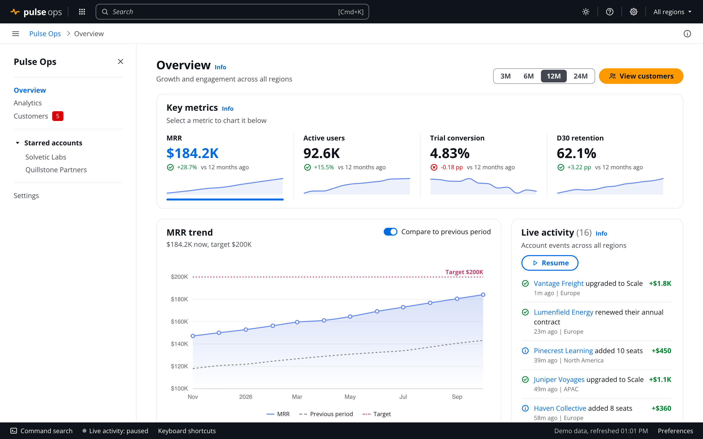

# preact-cloudscape-nobuild-template

Admin UI template with no build step: native ES modules and an import map load Preact, htm, @preact/signals and D3 from a CDN, styled with AWS Cloudscape design tokens.



Dark theme: [docs/screenshot-dark.png](docs/screenshot-dark.png)

> Unofficial. Not affiliated with or endorsed by AWS. Cloudscape is used through its published `@cloudscape-design/design-tokens` and `@cloudscape-design/global-styles` packages; the components are rebuilt in plain CSS, not the Cloudscape React library.

## Why no build

- No bundler, transpiler, `package.json` or `node_modules`. The files in `src/` are exactly what the browser runs.
- Nothing to install or configure: clone, serve the folder, open the page.
- Small modules, one job each. The whole codebase is quick to read in full, which keeps it easy to extend, by hand or with a coding assistant.

## Stack

| Package | Version | Role | Loaded from |
|---|---|---|---|
| `preact` | 10.26.4 | Rendering, hooks | esm.sh |
| `htm` | 3.1.1 | JSX-like syntax in tagged templates | esm.sh |
| `@preact/signals` | 2.0.1 | Reactive state | esm.sh |
| `d3` | 7.9.0 | Charts | jsdelivr |
| `@cloudscape-design/design-tokens` | 3.0.116 | Colors, radii, fonts, chart palette | jsdelivr |
| `@cloudscape-design/global-styles` | 1.0.71 | Reset, Open Sans, `applyMode`, `applyDensity`, `disableMotion` | jsdelivr, unpkg |

All versions are pinned in [index.html](index.html).

## How it works

### Import map

Bare specifiers resolve to CDN URLs, so source files import packages the usual way:

```html
<script type="importmap">
  {
    "imports": {
      "preact": "https://esm.sh/preact@10.26.4",
      "preact/hooks": "https://esm.sh/preact@10.26.4/hooks",
      "htm/preact": "https://esm.sh/htm@3.1.1/preact?external=preact",
      "@preact/signals": "https://esm.sh/@preact/signals@2.0.1?external=preact,preact/hooks",
      "d3": "https://cdn.jsdelivr.net/npm/d3@7.9.0/+esm"
    }
  }
</script>
```

`?external=preact` makes esm.sh leave `preact` as a bare import. The import map resolves it to the same URL, so htm, signals and the app share one Preact instance. Two copies would break hooks and signal subscriptions.

### htm instead of JSX

```js
import { html } from "htm/preact";

export function Panel({ title, children }) {
  return html`
    <section class="panel">
      <h2>${title}</h2>
      ${children}
    </section>
  `;
}

// components: <${Panel} title="Accounts">...<//>
```

### Data

Fixed records live in JSON under [src/data/](src/data/) (`accounts.json`, `metrics.json`, `funnel.json`, ...). [src/data/api.js](src/data/api.js) fetches them once at startup, like an API response, and uses top-level await so every module importing `seed` runs after the data arrives:

```js
const results = await Promise.all(files.map((name) => fetch(new URL(`./${name}.json`, import.meta.url)).then((r) => r.json())));
export const seed = Object.fromEntries(files.map((name, i) => [name, results[i]]));
```

`index.js` imports the app dynamically, so the boot message shows while data loads, and an error is shown if it fails. Pointing these URLs at real endpoints is the only change a backend needs. Values that depend on the current date (metric series, cohort labels) are generated in JS from parameters in the JSON.

### Signals for state

State lives in plain modules under `src/state/`. A component that reads `.value` re-renders when it changes; no providers or reducers.

```js
import { signal, computed } from "@preact/signals";
import { persistedSignal } from "../lib/storage.js";

export const searchTerm = signal("");
export const monthsBack = persistedSignal("range", 12); // mirrored to localStorage
export const filtered = computed(() => rows.filter((row) => row.name.includes(searchTerm.value)));
```

Revenue metrics are derived, never stored: [src/state/metrics-signals.js](src/state/metrics-signals.js) computes MRR, paying accounts, MRR per account, region shares, MRR by plan and the 30-day MRR movement from the accounts and their events, scoped by the region selector. Product analytics (active users, conversion, retention, funnel, cohorts) describe a user base the account records do not model, so they come from their own JSON.

Live activity changes the records it describes. An upgrade moves the account up a plan and raises MRR, added seats raise the seat count, and a failed payment marks the account past due. The table, account page, timeline and charts update with it. Accounts and events are persisted and synced, and exactly one tab generates events: it holds a [Web Lock](https://developer.mozilla.org/docs/Web/API/Web_Locks_API) until it closes, then the next tab takes over ([src/state/activity-signals.js](src/state/activity-signals.js)).

Persisted state stays reactive across tabs. `persistedSignal` ([src/lib/storage.js](src/lib/storage.js)) listens for the browser's `storage` event, so a change in one tab updates every other open tab without a reload. Per-tab layout state, such as whether the navigation is open, uses `sessionSignal` (`sessionStorage`) and is not shared.

### Cloudscape tokens

The tokens package exports CSS `var()` references with light-mode fallbacks, for example `var(--color-text-accent-xcihqq, #006ce0)`. [src/lib/cloudscape-tokens.js](src/lib/cloudscape-tokens.js) maps them onto the app's own custom properties:

```js
import { colorTextAccent, borderRadiusContainer } from "@cloudscape-design/design-tokens";

document.documentElement.style.setProperty("--color-blue", colorTextAccent);
document.documentElement.style.setProperty("--radius", borderRadiusContainer);
```

Without the React bundle those variables are never defined, so the fallbacks apply. Dark-mode values are set by hand in [src/styles/main.css](src/styles/main.css) under `body.awsui-dark-mode`.

Theme, density and motion call Cloudscape's own helpers ([src/state/settings-signals.js](src/state/settings-signals.js)):

```js
effect(() => applyMode(darkMode.value ? Mode.Dark : Mode.Light));
effect(() => applyDensity(compactDensity.value ? Density.Compact : Density.Comfortable));
effect(() => disableMotion(reduceMotion.value));
```

### D3 charts

Each chart is a render function that draws into a container, plus a small component that wires it up with `useChart` ([src/hooks/use-chart.js](src/hooks/use-chart.js)). The hook redraws when the data changes, or when a ResizeObserver reports a new container width. Colors come from CSS classes and variables, so charts follow the theme without redrawing.

```js
export function BarListChart({ items }) {
  const ref = useChart((node, options) => renderBarList(node, items, options), [items]);
  return html`<div ref=${ref} class="chart-host"></div>`;
}
```

### Routing

Hash routing in [src/router/router.js](src/router/router.js) (`#/customers/C-1044`). Hash routes work on any static host, including from a subpath.

## Run locally

ES modules need an HTTP server; `file://` does not work.

```sh
npx serve .
# or, Python 3.11+ (the default HTTP/1.0 mode drops parallel module requests)
python3 -m http.server 8000 --protocol HTTP/1.1
```

## Project structure

```
index.html            import map, entry script, theme applied before load
index.js              renders <App />
src/
  app.js              route table
  router/             hash router
  pages/              one module per route
  components/         layout, Cloudscape-style UI pieces
    charts/           D3 render functions and their components
  state/              signals: settings, UI, filters, live data
  hooks/              useChart, usePage, useHotkeys
  data/               *.json records, api.js loader, generators for series and events
  lib/                tokens bridge, storage, formatting, CSV
  styles/main.css     tokens, light/dark themes, components
docs/                 screenshots
```

## Extending

- **Page:** add a module in `src/pages/`, register it in the `routes` array in [src/app.js](src/app.js), and call `usePage({ title, topic, crumbs })` for the title, breadcrumbs and help topic.
- **Chart:** write `renderX(container, data, { animate })` in `src/components/charts/`, wrap it with `useChart`, and style it through CSS classes that use the `--chart-*` variables.
- **State:** export a `signal`, `computed` or `persistedSignal` from a module in `src/state/`.
- **Component:** follow the existing Cloudscape-style pieces in `src/components/` (`Panel`, `PageHeader`, `ButtonDropdown`, `Tabs`, `StatusIndicator`, `ProgressBar`).
- **Data:** add a JSON file in `src/data/`, list it in `files` in [src/data/api.js](src/data/api.js), and read it from `seed`.
- **Dependency:** add an entry to the import map and import it by name.

## Included UI

- **Layout:** top navigation with search and a region selector, side navigation, breadcrumb toolbar, help panel, message bar, footer bar
- **Command search** (Cmd/Ctrl+K) over pages, records and actions
- **Table:** text and select filters, sorting, pagination, row selection, bulk actions, CSV export
- **Charts:** line with comparison and target, bars, donut, funnel, heatmap, waterfall, sparklines
- **Settings:** light, dark and system themes; comfortable and compact density; reduced motion
- **Keyboard shortcuts:** `/`, `g` then a letter, `[`

## Deploy to GitHub Pages

Settings > Pages > Build and deployment > Deploy from a branch > `main`, `/ (root)`. No build workflow is needed. Relative paths and hash routing make it work under `https://<user>.github.io/<repo>/`.

## Limits

- Needs network access to esm.sh, jsdelivr and unpkg at runtime. To run offline, download the modules and point the import map at local copies.
- No type checking, linting or tests.
- Cloudscape is approximated with tokens and CSS, not the official components. Dark-mode values are maintained by hand.
- Sample records come from the JSON files; metric series, history and live events are generated in the browser from seeded random values.
- Live changes to accounts are saved in `localStorage`; Settings > Reset local data restores the JSON records.

## License

[MIT](LICENSE)
